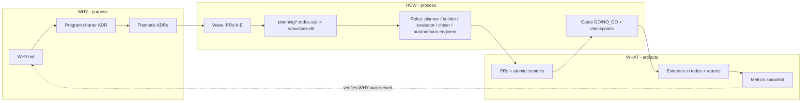
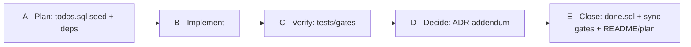

# WHW — Why · How · What: an agnostic harness for autonomous, evidence-gated delivery

## Decisions already confirmed

- Name: **WHW** (Why · How · What). No use of "Golden Circle" / "Start With Why" in product naming; inspiration credited with a non-affiliation disclaimer.
- Language: English primary, `README.pt-BR.md` translation.
- State: **SQLite** via built-in `node:sqlite` (`planning/*.todos.sql` seeds → `.whw/state.db`); PostgreSQL schema shipped as optional adapter.
- Runtime: **Node.js ≥ 22.13, zero runtime dependencies**, tests with `node:test`. Package `@fabioeloi/whw` (bare `whw` is taken on npm), binary `whw`. GitHub `fabioeloi/WHW` is free.
- License: MIT, `Copyright (c) 2026 Fabio Eloi` (matches FORGE/omni-architect). No portfolio language anywhere in the repo.

## Core model (inside-out)




Traceability rule: no todo without a wave, no wave without an ADR, no ADR without a WHY. Verification runs outside-in: evidence (WHAT) proves gates (HOW) satisfied the ADR's acceptance (WHY).

## Wave contract (generalized from the source methodology)




- Each letter = one small PR (or one atomic commit when working solo/no remote). Wave is `done` only when **E** merges.
- Waves are grouped into **programs** chartered by an ADR containing: context, explicit exclusions (deferred P0/P2 fronts), wave map (wave → slug → thematic ADR), execution rules, close wave with **inventory gate** asserting artifacts exist and **no wave N+1 exists without a new ADR**.
- Commit/branch conventions: `type(scope): summary (Wave 003 B)`, branches `feat/wave-003-<slug>-b`, `docs/wave-003-<slug>-e`.
- Narrative plan (`docs/plan.md`) uses **5W2H** rows A–E per wave; PR numbers recorded back into `todos.evidence`, the plan, and the ADR addendum.

## Repository layout

- Root: `README.md`, `README.pt-BR.md`, `LICENSE`, `ACKNOWLEDGMENTS.md`, `CHANGELOG.md`, `CONTRIBUTING.md`, `CODE_OF_CONDUCT.md`, `SECURITY.md`, `WHY.md`, `AGENTS.md` (canonical), `package.json`, `whw.config.json`
- Tool adapters (pointers to `AGENTS.md`): `CLAUDE.md` (`@AGENTS.md` import), `GEMINI.md`, `.github/copilot-instructions.md`, `.cursor/rules/whw.mdc`, `.windsurfrules`, `.gemini/settings.json` (`context.fileName: AGENTS.md`)
- `bin/whw.js` — entry (shebang suppresses `ExperimentalWarning` for `node:sqlite`)
- `src/`
  - `cli.js`, `config.js` (precedence: flags > env `WHW_*` > `whw.config.json` > defaults — omni-architect pattern), `log.js` (redacts keys matching `/token|secret|password/i`)
  - `db/sqlite.js` (`node:sqlite` `DatabaseSync`), `db/postgres.sql` schema only + adapter interface
  - `planning/seed.js` (idempotent upsert that never downgrades `done`), `queue.js` (ready = pending with all deps done/cancelled; `in_progress` first), `transitions.js` (claim/done/block/cancel/note + audit table)
  - `scaffold/adr.js`, `scaffold/program.js`, `scaffold/wave.js` (generates `planning/wave-NNN-<slug>.todos.sql` + `.done.sql` with A–E and E→A..D deps)
  - `gates/runner.js` + `gates/builtin/*` (see Gates), checkpoints to `.whw/checkpoints/<gate>/latest.txt` + timestamped copy
  - `evaluate.js` — Phase A deterministic runner (configured lint/test/build commands) → `evaluation-report.json`; Phase B rubric (4 criteria, weights 1.3/1.3/1.0/1.0, 0–5, threshold 3.5, REJECT emits top-3 fixes) produced as a model-agnostic prompt + JSON ingest
  - `close.js`, `report.js` (Status / Evidence / Next step), `metrics.js`, `handoff.js`, `adapters.js`, `doctor.js`
  - `run.js` — optional agent runner: `whw run <role>` composes role prompt + `AGENTS.md` + queue context and invokes a configured CLI (`claude`, `codex`, `cursor-agent`, `gemini`, `aider`, `opencode`, custom); honors an **escalation ladder** (tier 0..N with `maxFailures`, final tier = human) from FORGE
- `sql/schema.sqlite.sql`, `sql/schema.postgres.sql`
- `roles/` — model-agnostic prompts: `planner.md` (compaction context), `builder.md` (reset + handoff files), `evaluator.md` (reset, stateless), `closer.md`, `autonomous-engineer.md` (full loop, SQL is source of truth, never in-chat todo lists as canonical state, Status/Evidence/Next mandatory, resume-after-interruption protocol, escalate-when rules)
- `skills/whw-*/SKILL.md` — agentskills.io-compliant (`name` matches dir, `description` what+when, `license: MIT`, `metadata.version`): `whw-autonomous-engineer`, `whw-plan-wave`, `whw-evaluate`, `whw-close-wave`, `whw-adr`, `whw-handoff`
- `templates/` — `WHY.md`, `AGENTS.md`, `adr.md`, `program-charter.md`, `wave.todos.sql`, `wave.done.sql`, `plan-wave-5w2h.md`, `pull_request_template.md`, `handoff.md`, `status-report.md`, `evaluation-criteria.md`
- `docs/`
  - `why/` — manifesto (WHY/HOW/WHAT mapping + disclaimer), principles (purpose-first, evidence over chat, SQL as source of truth, lean gates / anti "CI theater", small PRs, honest abandonment, continuity), `positioning.md` (six-dimension taxonomy: specification, context, roles, execution, validation, portability + purpose; vs Spec Kit, OpenSpec, BMAD, GSD, Ralph loop, sdd-harness, cc-sdd)
  - `how/` — waves, programs, adrs, self-management (`todos.sql`), gates & checkpoints, evidence & reporting, continuity & IDE handoff (git baseline, chat-path map, checklist), roles & context strategy, escalation, evaluation, conventions (commits/branches/5W2H)
  - `what/` — CLI reference, schema, config reference, templates, adapters, metrics
  - `adr/` — WHW's own: 0001 name & scope, 0002 SQLite default, 0003 Node zero-dep, 0004 AGENTS.md canonical + adapters, 0005 wave contract A–E, 0006 gate tiers (PR-blocking vs operational), 0007 licensing & attribution policy, 0008 Program 001 charter
  - `plan.md`, `glossary.md`, `handoff/`
- `planning/` — dogfood: WHW's own Program 001 waves as `wave-001-*.todos.sql`
- `examples/hello-wave/` — minimal repo showing the full loop
- `tests/` — unit (`db`, `seed`, `queue`, `transitions`, `wave`, `gates`, `config`, `report`) + e2e (`init → adr → program → wave → sync → claim → done → close → gates` in a temp dir)
- `.github/workflows/ci.yml` (Node 22/24 matrix: `npm test`, `whw doctor`, `whw gate run --tier pr`), `pull_request_template.md`, issue templates

## `todos.sql` schema (SQLite; fresh names, no origin identifiers)

```sql
CREATE TABLE IF NOT EXISTS todos (
  ref TEXT PRIMARY KEY, title TEXT NOT NULL,
  status TEXT NOT NULL DEFAULT 'pending'
    CHECK (status IN ('pending','in_progress','done','blocked','cancelled')),
  track TEXT NOT NULL, step INTEGER NOT NULL CHECK (step BETWEEN 1 AND 999),
  letter TEXT CHECK (letter IN ('A','B','C','D','E')), adr TEXT,
  notes TEXT, evidence TEXT,
  created_at TEXT DEFAULT (datetime('now')), updated_at TEXT DEFAULT (datetime('now'))
);
CREATE TABLE IF NOT EXISTS todo_deps (
  ref TEXT REFERENCES todos(ref) ON DELETE CASCADE,
  depends_on TEXT REFERENCES todos(ref) ON DELETE CASCADE,
  PRIMARY KEY (ref, depends_on), CHECK (ref <> depends_on)
);
CREATE TABLE IF NOT EXISTS transitions (id INTEGER PRIMARY KEY, ref TEXT, from_status TEXT,
  to_status TEXT, actor TEXT, evidence TEXT, at TEXT DEFAULT (datetime('now')));
CREATE VIEW IF NOT EXISTS ready AS /* pending todos whose deps are all done/cancelled */ ...;
```

## CLI surface

- `whw init [--tools claude,cursor,codex,copilot,gemini,windsurf]` · `whw doctor` · `whw adapters sync`
- `whw adr new <slug>` · `whw program new <slug> --waves N` · `whw wave new <slug> --adr NNNN`
- `whw sync [track|--all]` · `whw queue` · `whw claim <ref>` · `whw done <ref> --evidence "..."` · `whw block <ref> --reason` · `whw cancel <ref>` · `whw note <ref>`
- `whw status [--track]` → Status / Evidence / Next step markdown
- `whw gate list` · `whw gate run [name|--tier pr|--all]` → GO/NO_GO, exit code, checkpoint file
- `whw evaluate --phase a|b` → `evaluation-report.json`
- `whw close <wave>` → asserts A–D done + ADR addendum exists, runs sync gates, applies `.done.sql`, marks E
- `whw metrics [--json]` · `whw handoff --from <tool> --to <tool>` · `whw run <role> [--ref] [--runner]`

## Gates (built-in, generic; custom gates = any shell command in `whw.config.json`)

- `planning-coverage` — every `planning/*.todos.sql` applied; every todo has track + ADR
- `adr-link` — every wave references an existing ADR; program ADR has a wave map
- `program-inventory <program>` — required ADRs/SQL/artifacts exist; no wave beyond the chartered range
- `wave-sync` — every closed wave has ADR addendum, plan entry, `.done.sql`
- `readme-sync` — README status claims match DB state
- `agents-parity` — all adapter pointer files exist and reference `AGENTS.md`
- `no-secrets` — regex scan (emails, tokens, private keys, cloud IDs)
- Tiers: `pr` (blocking, lean) vs `ops` (on demand) — explicit anti-cascade philosophy documented.

## Licensing and provenance safeguards

- `LICENSE` MIT © 2026 Fabio Eloi; `// SPDX-License-Identifier: MIT` headers in source.
- `ACKNOWLEDGMENTS.md`: FORGE and omni-architect (MIT, patterns adapted), Simon Sinek's Why/How/What idea from *Start With Why* (2009) as inspiration only — not affiliated/endorsed, no text reproduced; AGENTS.md (Agentic AI Foundation / Linux Foundation); Agent Skills spec; taxonomy paper (arXiv 2606.04967) for positioning; Node.js, SQLite.
- Origin hygiene: only mechanisms are reused; new vocabulary (`wave`, `track`, `program`, `todos`/`todo_deps`), numbering restarts at 001, no product/host/schema names, no copied SQL files, ADR contents, or scripts. `no-secrets` gate + a pre-publish grep for origin identifiers run before the first push.
- Docs cite the origin only as "a long-running production project by the author" without naming it.

## Dogfooding and delivery

- WHW is built with WHW: `WHY.md`, `AGENTS.md` + adapters, `docs/adr/0008` charters **Program 001**, and `planning/wave-001..00N` track the construction itself; commits follow the A–E convention so the repo's own history is evidence.
- Git: rename `master` → `main`, initial commits by wave letter, tag `v0.1.0`. Creating the public GitHub repo `fabioeloi/WHW` and pushing is the final step and will be proposed for explicit confirmation (external, irreversible).
- Verification: `npm test` (unit + e2e), `whw doctor` and `whw gate run --tier pr` green on the repo itself, `examples/hello-wave` runs end-to-end.

