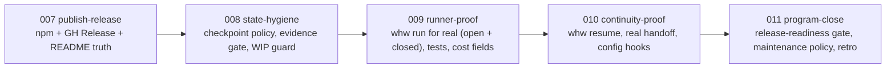

# WHW review: prompt × plan × implementation → dogfood gaps → Program 002

## Verdict

v0.1.0 delivers the full surface the plan promised (CLI, SQL planning, 7 gates, roles, skills, templates, docs, ADRs 0001–0008, example, 34 tests, CI). The gaps are not in *what* was built but in *how WHW treats itself*: the public quick start does not work, derived state is committed, evidence strings are not re-runnable, three commits landed after the program closed with no wave, and the runner/handoff/continuity features were never exercised for real. CI is green as of `c36e1d9`.

## 1. Prompt → plan → implementation coverage

**Delivered as asked**

- Why/How/What as inspiration only, disclaimer + no product naming: [README.md](README.md), [ACKNOWLEDGMENTS.md](ACKNOWLEDGMENTS.md), [docs/adr/0007-licensing-attribution.md](docs/adr/0007-licensing-attribution.md).
- Wave A–E + ADRs + programs with exclusion charters + inventory gate: [docs/adr/0005-wave-contract.md](docs/adr/0005-wave-contract.md), [src/close.js](src/close.js), [src/gates/builtin/program-inventory.js](src/gates/builtin/program-inventory.js).
- `todos.sql` self-management with audited transitions, `done` terminal, evidence required: [sql/schema.sqlite.sql](sql/schema.sqlite.sql), [src/planning/transitions.js](src/planning/transitions.js).
- `autonomous-engineer` + planner/builder/evaluator/closer roles with FORGE context strategies: [roles/](roles/), [skills/](skills/).
- FORGE two-phase evaluation (weights 1.3/1.3/1.0/1.0, threshold 3.5) and escalation ladder ending in human: [src/evaluate.js](src/evaluate.js), [src/run.js](src/run.js).
- omni-architect config precedence (flags > env > file > defaults), JSON reports, HANDOFF-style package: [src/config.js](src/config.js), [src/handoff.js](src/handoff.js).
- Zero deps, MIT, SPDX headers, no portfolio language (grep clean), no private-origin identifiers.

**Promised but thin or missing**

- README claims an `ops` "release readiness" gate ([README.md](README.md) line 155); only `program-inventory` exists.
- Plan said `no-secrets` scans "emails … cloud IDs"; implementation covers keys/tokens only ([src/gates/builtin/no-secrets.js](src/gates/builtin/no-secrets.js)). Acceptable (author email is public) — align the docs.
- Plan said "commits by wave letter so the repo's history is evidence"; history has one commit per wave (6 `E` commits in 30 s) plus 3 unwaved commits. The A–E cadence has not been demonstrated on this repo.
- `README.pt-BR.md` lacks the Roadmap section (7 vs 8 sections) — drift.

**Source patterns deliberately left behind (candidates for the roadmap)**

- FORGE: budget/cost tracking per tier, agent-scoped pre/post hooks, session audit logs. WHW has `.whw/runs/` only when `whw run` is used.
- omni-architect: lifecycle `hooks` in config (`on_*`), `orchestration-log.json`, `session-state.json` resume file. WHW relies on `transitions` + checkpoints.
- Kanban origin: board view / WIP limit. "One claim at a time" is a rule in [AGENTS.md](AGENTS.md) but `whw claim` does not enforce it; no `in_review` lane between build and done.

## 2. Dogfood gaps (evidence-backed, by severity)

1. **Quick start is false.** `npm view @fabioeloi/whw` → 404. README step 1 (`npx @fabioeloi/whw doctor`) and every consumer's [templates/ci-whw.yml](templates/ci-whw.yml) (`npx -y @fabioeloi/whw@latest`) fail. No GitHub Release exists although [CHANGELOG.md](CHANGELOG.md) links to `releases/tag/v0.1.0`.
2. **Program rule violated by the repo itself.** `344731d`, `12e88b0`, `c36e1d9` landed after Program 001 closed, with no wave, no todo, no trailer — while [docs/adr/0008-program-001.md](docs/adr/0008-program-001.md) says "no wave 007 without a new charter". A charter (or an explicit maintenance policy) is overdue.
3. **First public CI run was red** (fixed today): gates depended on gitignored `state.db`; `doctor` reported `OK state (0 todos)`. The pipeline was never run from a clean checkout before publishing; the same defect shipped in the consumer template.
4. **Evidence is not re-runnable.** 24/30 todos carry `Program 001 session: letter X shipped + verified` — contradicts AGENTS.md ("must name artifacts a stranger could re-run"). `done` is terminal, so only `whw note` can append; needs a policy plus an `evidence-quality` gate for future waves.
5. **Derived state is tracked.** 35 timestamped checkpoint files + `latest.txt` + `.whw/metrics.json` + `.whw/evaluation-report.json` are in git; every gate run dirties the tree (18 dirty paths after today's debugging). Intent in docs is "latest.txt committed as proof" — timestamped copies should be ignored ([.gitignore](.gitignore), `GITIGNORE_BLOCK` in [src/scaffold/init.js](src/scaffold/init.js)).
6. **Metrics cited as close evidence are incomplete.** [.whw/metrics.json](.whw/metrics.json) has `git: null` everywhere — snapped at 16:33:40Z, one minute before the first commit (16:34:45Z).
7. **Runner, handoff, continuity never exercised.** `runners.default: null`, no `.whw/runs/`, no `docs/handoff/` in this repo. [src/run.js](src/run.js) has zero tests; `doctor.js` zero tests; handoff only via e2e smoke. Only closed-model runner examples in [docs/how/escalation.md](docs/how/escalation.md) — the "any model, open or closed" claim lacks a worked open-weight example.
8. **Docs drift after close.** [docs/plan.md](docs/plan.md) `## Next` is stale; ADR 0008 close-criteria checkboxes unchecked though closed; CHANGELOG `[Unreleased]` empty despite `fix(ci)`; README roadmap unchanged.
9. **Vacuous GO on empty DB.** `wave-sync`, `adr-link`, `readme-sync` pass with 0 todos (logged `closed: 0, failureCount: 0`). Only `planning-coverage` catches it. A runner-level "state unsynced" precondition would make the whole tier fail loudly.
10. **Repo hygiene on GitHub.** No branch protection on `main` (the "never merge on red" rule is unenforced), no topics, Actions warn `checkout@v4`/`setup-node@v4` target deprecated Node 20, no Dependabot for actions, no release workflow.

## 3. Roadmap evolution — Program 002 (ADR 0009)

Per [AGENTS.md](AGENTS.md) "broad demands": plan + seeds first, implement only after an explicit go. Proposed charter: **Program 002 — Hardening & Publication**, waves 007–011, each with its own ADR where a decision is made. Work happens on real branches/PRs against `origin` so this program's history *is* the A–E demonstration Program 001 lacked.

- **007 publish-release** (ADR 0010 release policy): `release.yml` publishing `@fabioeloi/whw` on tag with provenance; GitHub Release v0.1.1 (CI fix + doctor warn); topics; bump `actions/`* versions; Dependabot for actions; branch protection requiring `ci`; README quick start made true (remove `node_modules/.bin` line); pt-BR sync; CHANGELOG. *npm publish is external/irreversible — confirm at execution time.*
- **008 state-hygiene** (ADR 0011 derived-state policy): ignore timestamped checkpoints, keep `latest.txt`; re-snap metrics; `evidence-quality` gate in `ops` (evidence must contain SHA / PR # / test command / checkpoint path); `whw claim` refuses a second `in_progress` for the same actor unless `--force-wip`; gate runner NO_GO when seeds exist and `todos = 0`; tests for `doctor`, `claim` guard, runner precondition; fix docs drift from §2.8.
- **009 runner-proof**: exercise `whw run builder --ref …` with one open-weight runner (e.g. `aider` + local model, or `opencode`) and one closed CLI on a real wave todo; commit `.whw/runs/*.log` tails as evidence; unit tests for `composePrompt`, `resolveTiers`, escalation → exit 3; optional `cost`/`budget` per tier surfaced in `whw metrics` (FORGE lineage); document open-model examples in `docs/how/escalation.md`.
- **010 continuity-proof**: `whw resume` (one shot: git baseline → `sync --all` → `queue` → `gate run --tier pr` → delta report); produce a real `docs/handoff/` by migrating this repo between two tools mid-wave; `hooks` in `whw.config.json` (`on_claim`, `on_done`, `on_gate_fail`, `on_close`) as shell commands (omni-architect lineage).
- **011 program-close**: implement the `release-readiness` gate README already advertises (tag matches `package.json`, CHANGELOG entry, CI green, `pr` tier GO); ADR 0012 maintenance policy defining what may land outside a wave (e.g. `chore(maint)` with a linked issue) so §2.2 cannot recur; inventory GO; metrics; retrospective addendum.

**Later (not chartered):** `whw serve`, live PostgreSQL adapter, `whw migrate` importers, `whw board` (kanban view with WIP), `in_review` status, multi-track dependency visualization.

## 4. Decisions already taken in this plan (override if you disagree)

- Vehicle is a **new program charter**, not ad-hoc fixes on `main` — it is the repo's own rule and the fastest way to repair §2.2.
- Checkpoint policy: **track `latest.txt` only**; timestamped copies become local history.
- Historic evidence strings are **not rewritten** (`done` is terminal, "honest abandonment"); the gate applies from wave 007 onward, and a `whw note` on `wave00N-E` records the retro finding.
- Release **v0.1.1**, not a re-tag of v0.1.0.

## Housekeeping (no charter needed)

- `.cursor/debug-55c0dd.log` left from today's debug session is gitignored (`*.log`); delete it.
- 18 dirty `.whw/checkpoints/*` paths from today's gate runs: leave uncommitted until wave 008 decides the policy.

