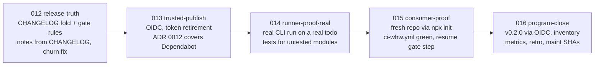

# WHW review: Program 002 plan × implementation → dogfood gaps → Program 003

## Verdict

Program 002 delivered what [the plan](.cursor/plans/whw_review_and_program_002_5ec837ee.plan.md) chartered: five waves closed on real PRs [#1](https://github.com/fabioeloi/WHW/pull/1)–[#27](https://github.com/fabioeloi/WHW/pull/27) (the A–E demonstration Program 001 lacked), ADRs 0009–0012 Accepted, 9 gates, 56 tests, branch protection, Dependabot, `release.yml`, and — today, post-close — `@fabioeloi/whw@0.1.1` on npm plus GitHub Release `v0.1.1`. The new gaps are again in *how WHW treats itself*, and the publish surfaced most of them: the 0.1.1 tarball ships features the CHANGELOG calls Unreleased, release notes ignore the CHANGELOG, publishing rides a bypass-2FA token npm is deprecating, ADR 0012 does not cover Dependabot, the runner was proven only with stubs, and every PR still carries checkpoint churn. `main` is green at `bf1f149`.

## 1. Plan → implementation coverage (Program 002)

**Delivered as planned**

- 007 publish-release: [.github/workflows/release.yml](.github/workflows/release.yml), Dependabot, topics, `main` protection (`whw (node 22)`/`(node 24)`, strict, no force-push), README truth, pt-BR Roadmap — ADR [0010](docs/adr/0010-release-policy.md).
- 008 state-hygiene: timestamped checkpoints ignored, `evidence-quality` gate, `claim --force-wip` guard, runner `unsynced-state` NO_GO, metrics re-snapped with git fields — ADR [0011](docs/adr/0011-derived-state.md).
- 009 runner-proof: `composePrompt`/`resolveTiers` tests, escalation → exit 3, `model`/`costClass` on tiers, open-model examples in [docs/how/escalation.md](docs/how/escalation.md).
- 010 continuity-proof: `whw resume`, config `hooks`, [docs/handoff/handoff-20260910-cursor-to-claude.md](docs/handoff/handoff-20260910-cursor-to-claude.md).
- 011 program-close: `release-readiness` gate, ADR [0012](docs/adr/0012-maintenance-policy.md), inventory GO, metrics, retro.
- Evidence strings 007+ are re-runnable (PR # + commit + test/gate command) — the `evidence-quality` gate did its job.

**Promised but thin or deviated**

- 009 said "one open-weight runner (aider + local model) and one closed CLI on a real wave todo"; shipped stubs (`exit 7` → `exit 0`). `runners.default` is still `null` in [whw.config.json](whw.config.json). Cost fields are logged per run, not surfaced in `whw metrics`.
- 010 said "migrate this repo between two tools mid-wave"; the handoff was produced by Cursor but never consumed/round-tripped. `whw resume` omits the planned `gate run --tier pr` step (git → sync → queue → next only).
- 007 said protection requires `ci`; it requires the matrix jobs (documented, acceptable).
- 011's ADR 0012 deferred a maint-abuse gate; abuse arrived the same day (see §2.4).

## 2. Dogfood gaps (evidence-backed, by severity)

1. **Published tarball ≠ CHANGELOG.** `fabioeloi-whw-0.1.1.tgz` contains `src/resume.js`, `src/hooks.js`, `src/gates/builtin/evidence-quality.js`, `release-readiness.js`; [CHANGELOG.md](CHANGELOG.md) lists all of them under `[Unreleased]` and `[0.1.1]` describes only wave 007. [release-readiness.js](src/gates/builtin/release-readiness.js) only checks that a `## [version]` heading exists.
2. **Release notes ignore the CHANGELOG.** ADR 0010 rule: "every `v*` tag gets a Release whose notes match CHANGELOG". `release.yml` uses `gh release create --generate-notes` (a PR list) and never runs `release-readiness`.
3. **Publish identity is a deprecated path.** First publish failed `EOTP`; the fix was a bypass-2FA automation token in `NPM_TOKEN`. npm restricts these tokens now and removes direct publish ~Jan 2027. The package exists, so trusted publishing (OIDC) is available; `id-token: write` is already set.
4. **ADR 0012 has a hole and its clock is running.** `18f6e5c`, `348a3fc` (`chore(deps)`, Dependabot) and merge `0eaeca7` landed with no `maint` issue and no trailer; [.github/dependabot.yml](.github/dependabot.yml) labels PRs `maint` but the ADR requires an *issue*. Plus `2d6387a`, `769dda9` (proper maint). ADR 0012: "open or extend a wave … or charter the next program within one working day" → a charter is due.
5. **`npm publish` auto-corrected package.json.** Log: `"bin[whw]" script name bin/whw.js was invalid and removed` (leading `./`) and `repository.url` normalized to `git+https://…`. `release-readiness` accepted it.
6. **Checkpoint churn persists.** 8 tracked `latest.txt` files change on every gate run (timestamps); PR [#29](https://github.com/fabioeloi/WHW/pull/29) was 11 files, 6 of them checkpoints. `.whw/evaluation-report.json` is still tracked (derived). `evidence-quality/latest.txt` was never committed while `program-inventory`/`release-readiness` were — `ops` checkpoints are inconsistent.
7. **Runner and handoff still unproven for real** (see §1). Untested modules: `handoff.js`, `close.js`, `metrics.js`, `adapters.js`, scaffold `init/program` (e2e only).
8. **Consumer path never executed end-to-end.** `templates/ci-whw.yml` (`npx -y @fabioeloi/whw@latest sync --all` in a consumer repo) and `whw init` on a fresh repo → green CI have not been demonstrated. `npx @fabioeloi/whw@0.1.1 doctor` failed once with `sh: whw: command not found` minutes after publish (unversioned `npx` worked); reproduce or rule out.
9. **Stale docs after publish.** [README.md](README.md) L210 "WHW's own decisions (0001–0008)"; [docs/plan.md](docs/plan.md) L125/L190 "tag waits on `NPM_TOKEN`", Programs list lacks **closed** for 002; [SECURITY.md](SECURITY.md) L39 describes the token path; `wave007-B` evidence cites dead PR #2 (superseded by #3).

## 3. Roadmap evolution — Program 003 (ADR 0013): Trust & Adoption

Same vehicle as last time: a charter, five waves, seeds first, go before 012 B. Ships **v0.2.0** at close (semver minor: `resume`, hooks, gates are features).

- **012 release-truth** (ADR 0010 + 0011 addenda): move waves 008–011 entries under `[0.1.1]` with a one-line "changelog lagged the tarball" note; `release-readiness` adds rules — `[Unreleased]` must be empty when `HEAD` is tagged `v<version>`, `bin` paths without `./`, `repository.url` in `git+` form; `release.yml` runs `gate run release-readiness` and builds notes from the CHANGELOG section (`--notes-file`); make `latest.txt` deterministic (no timestamp) so a GO run leaves the tree clean; untrack `.whw/evaluation-report.json`; commit or ignore `ops` checkpoints consistently; fix §2.9 stale docs.
- **013 trusted-publish** (ADR 0014): configure npm trusted publisher for `release.yml`; drop `NODE_AUTH_TOKEN`; set package to "require 2FA and disallow tokens"; revoke the automation token; SECURITY.md update; ADR 0012 addendum: Dependabot `chore(deps)` is maint with the `maint` label as the link, one dependency per PR, matrix green — and an `ops` `maint-audit` gate listing non-trailer commits since the last close. Proof lands in 016 (first OIDC publish).
- **014 runner-proof-real**: `whw run builder --ref wave014-B` with one CLI the operator actually has (confirm at 014 A; `doctor` should detect installed runners); commit the `.whw/runs/*.log` tail into the ADR addendum; unit tests for `handoff.js`, `close.js`, `metrics.js`, `adapters.js`; surface `costClass` in `whw metrics`.
- **015 consumer-proof**: e2e test that scaffolds a fresh temp repo with `init`, runs the exact `templates/ci-whw.yml` steps against the local bin, and asserts `pr` gates GO; round-trip a handoff (produce in one tool, `whw resume` in another, record both baselines); add the planned `gate run --tier pr` step to `resume`; reproduce/close the `npx @…@0.1.1` bin issue.
- **016 program-close**: tag `v0.2.0` (operator go) → OIDC publish is the 013 proof; `program-inventory` GO; metrics; ADR 0012 close-hygiene lists maint SHAs (`2d6387a`, `769dda9`, `18f6e5c`, `348a3fc`, `0eaeca7`); retrospective.

**Later (not chartered):** `whw serve`, live PostgreSQL adapter, `whw migrate`, `whw board` + `in_review`, multi-track dependency view — carried as explicit exclusions in ADR 0013.

## 4. Decisions taken in this plan (override if you disagree)

- Vehicle is **Program 003 via charter**, not more `chore(maint)` — that is ADR 0012's own instruction after today's five post-close commits.
- CHANGELOG is corrected by **folding into `[0.1.1]` with a note** (docs truth, no re-tag, no 0.1.2); next version is **0.2.0** at 016 E.
- Historic evidence (`wave007-B` → PR #2) is **not rewritten**; a `whw note` records the supersession.
- Trusted publishing replaces the token; the token is revoked only after 016's OIDC publish succeeds.

## Execution of this plan (seeds only — then stop)

1. `node ./bin/whw.js program new trust-adoption --waves 5 --title "Trust & Adoption"` → `docs/adr/0013-program-trust-adoption.md`; fill context, exclusions, wave map 012–016, execution (real PRs, `feat/wave-NNN-<slug>-<letter>`), close criteria (incl. `v0.2.0` on npm via OIDC).
2. `node ./bin/whw.js wave new release-truth --adr 0013`, then `trusted-publish`, `runner-proof-real`, `consumer-proof`, `program-close` (each `--adr 0013`); sharpen seed notes with the bullets above; `whw sync --all`; `whw gate run --tier pr` and `--tier ops` GO.
3. [docs/plan.md](docs/plan.md): mark Program 002 **closed**, add Program 003 + 5W2H stubs for 012–016, refresh `## Next`; `whw note wave007-B` about PR #2 → #3.
4. Open PR `docs/wave-012-release-truth-a` (Wave 012 A). Report Status / Evidence / Next step and **wait for an explicit go** before 012 B.

Assumption to confirm at 014 A: which agent CLI is installed on the operator machine for the real runner proof.